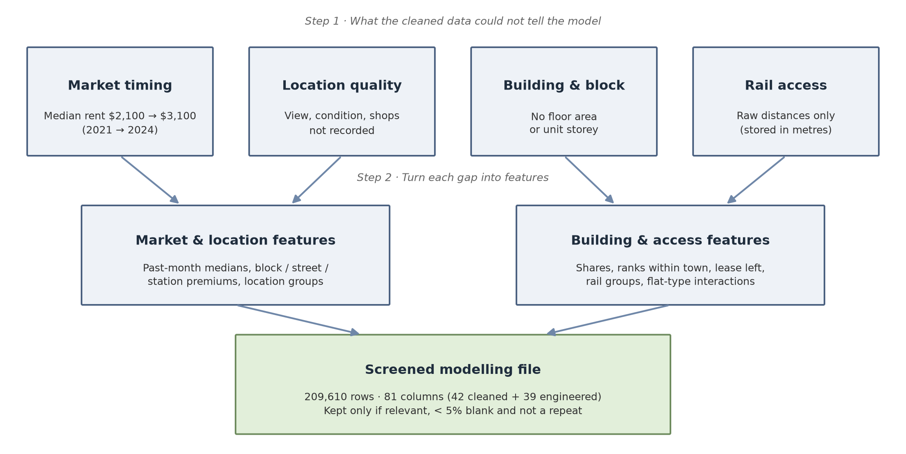
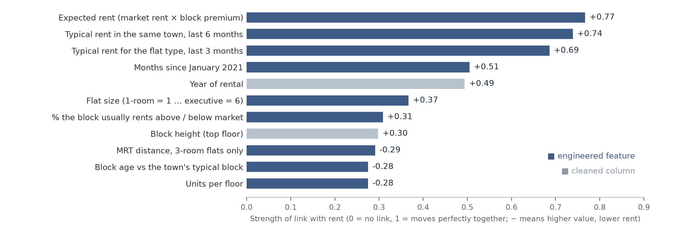

# Singapore HDB Rental Price Prediction: Feature Engineering

**TL;DR:** I engineered 39 features that capture what drives HDB rents but wasn't in the raw data: market timing, location premium, MRT access and building profile. 8 of the model's top 13 predictors are engineered features, and the location-premium features cut a Ridge model's prediction error by **27% ($651 → $478 RMSE)**.

**Tools:** Python · pandas · NumPy



## Business question

What drives the monthly rent of a Singapore HDB flat, and how can we predict it more accurately? Better rent estimates help tenants and landlords judge a fair price, and help planners see where rents are rising fastest.

## Dataset

**209,610 HDB rental records from 2021 onwards, with 42 cleaned columns.** The source data is public: HDB rental approvals from data.gov.sg, combined with HDB property information and MRT/LRT exit locations.

The cleaned data leaves out much of what drives rent:

- **Market timing:** the median rent rose from about $2,100 to $3,100 between 2021 and 2024, so the same flat costs different amounts in different months.
- **Location quality:** a flat's view, condition and nearby shops are not recorded.
- **Building and unit:** there is no floor area or unit storey.
- **Rail access:** only raw distances are given, and they are stored in metres despite the `_km` column names.

The data files are not included because they are larger than GitHub's 100 MB file limit.

## Approach

1. **Find the gaps:** check each column against rent and ask what a landlord or tenant uses to set a price that the data doesn't show.
2. **Draft candidates:** 48 candidate features built only from the 42 cleaned columns, with no outside data.
3. **Screen them:** keep a feature only if it is relevant to rent, under 5% blank, not a repeat of another column, and built only from earlier months. 9 candidates failed and were dropped.


**What I built (39 features):**

| Group | Examples | Idea |
|---|---|---|
| Market level | `ft_median_rent_lag3m`, `town_ft_median_rent_lag6m` | Recent market rent for the same flat type and town |
| Location premium | `block_ft_past_premium`, `street_past_premium`, `station_past_premium`, `expected_rent_block_ft` | How much a block, street or station area has rented above or below the market in the past |
| Location | `postal_district`, `mature_estate`, `region` | Standard Singapore location groupings |
| Rail | `lrt_dependent`, `mrt_dist_rank_in_town`, `rail_access_category` | LRT-only access, and how close a block is to the MRT compared with the rest of its town |
| Building | `remaining_lease_years`, `completion_era`, `floor_rank_in_town` | Lease left, build generation, and height within the town |
| Rental activity | `block_rentals_past12m`, `town_ft_rentals_lag3m` | How busy the local rental market is |

The full definitions, formulas and reasons for each feature are in [`feature_dictionary.csv`](feature_dictionary.csv) and [`FEATURES.md`](FEATURES.md).

## Model evaluation



- The new market-rent and block-premium features have the strongest links with rent (correlation **0.69 to 0.77**). The best original column, the year of rental, reaches only **0.49**.
- Adding the location-premium features cut a Ridge model's error from **$651 to $478 RMSE (−27%)**.

## Key results


- **8 of the model's top 13 predictors are engineered features**, including the top three: expected rent, months since January 2021 and the block premium.
- **Expected rent alone carries 31% of the model's explanation.** Example: a 4-room flat at Block 147 Lorong 2 Toa Payoh in January 2024. The typical 4-room rent was $3,300, and this block usually rents about 12% above market, so its expected rent is about $3,699. The actual rent was $3,500.
- Rail, building and rental-activity features are **not** among the top 13, so location and market timing matter far more than MRT distance or building age.

## Recommendation

- **Price from the local market, not the flat alone.** The going rate for the flat type, adjusted by the block's usual premium, predicts rent better than any flat attribute. Tenants and landlords can use this "expected rent" as a fair-price benchmark.
- **Update estimates often.** Rents moved about 50% in three years, so any rent model needs recent market data to stay accurate.
- **Collect floor area and storey.** They are the biggest missing drivers. Adding them would likely improve accuracy more than further feature work.

## Limitations

- There is no floor area, storey or flat condition in the data, so the block-level features can only approximate them.
- Blocks with few past rentals have unreliable premiums. They are pulled toward the market average, which reduces noise but can hide real differences.
- The features show what predicts rent, not what causes it.
- I built the features. The final model was built by teammates as part of a wider team project.

## How to run

```bash
pip install pandas numpy
python create_features.py
```

The script expects the cleaned input at `data/hdb_rentals_clean.csv`.

## About this project

This was a team rent-prediction project using public Singapore data. I was responsible for the **feature engineering** stage.
