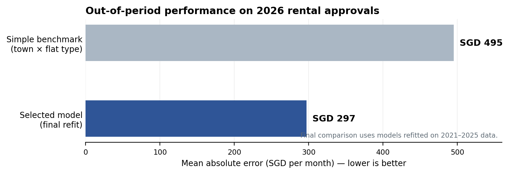
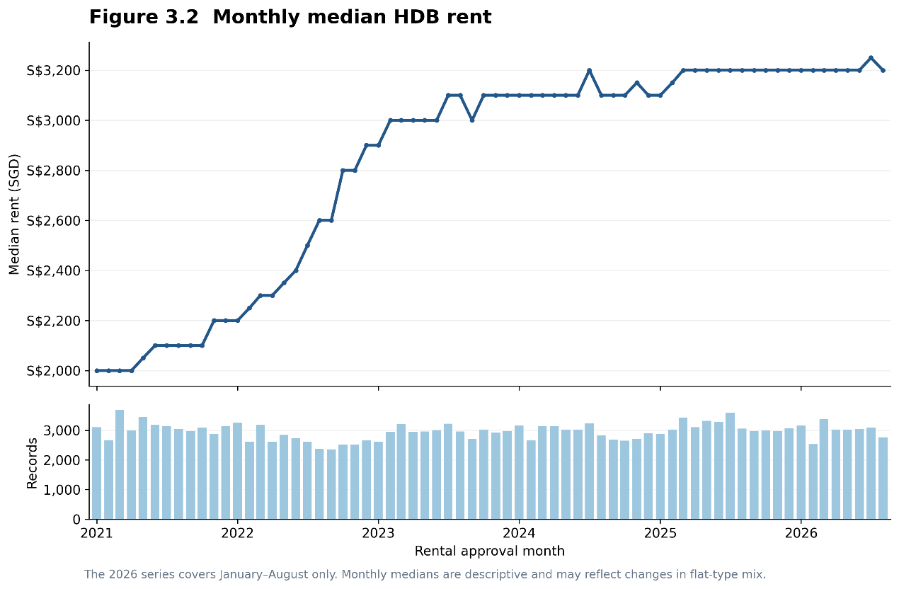
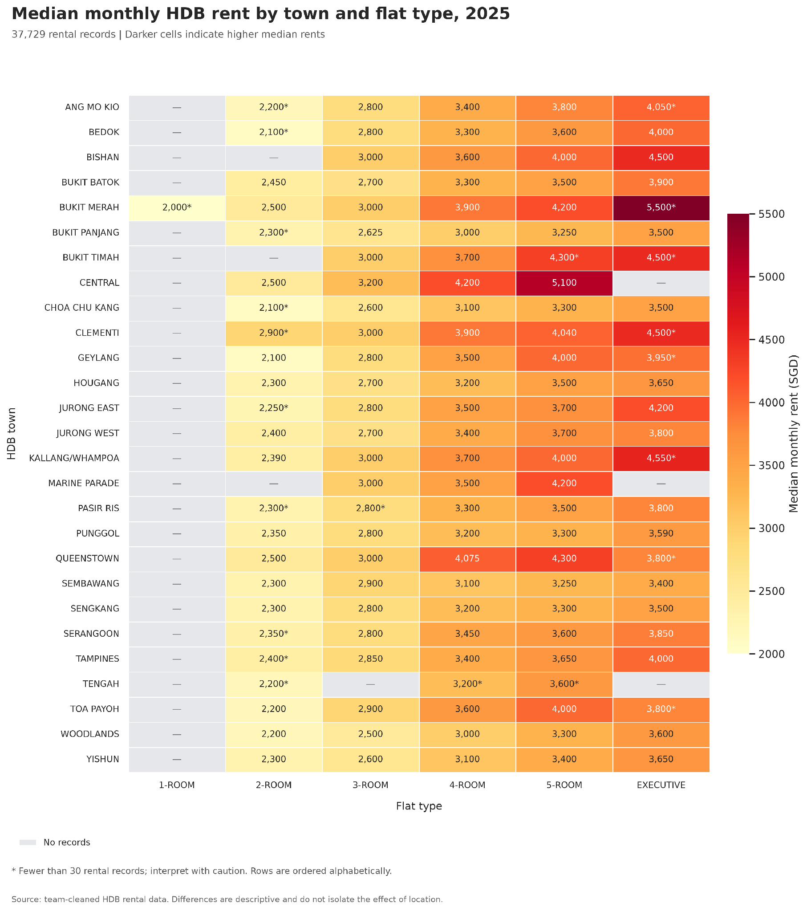
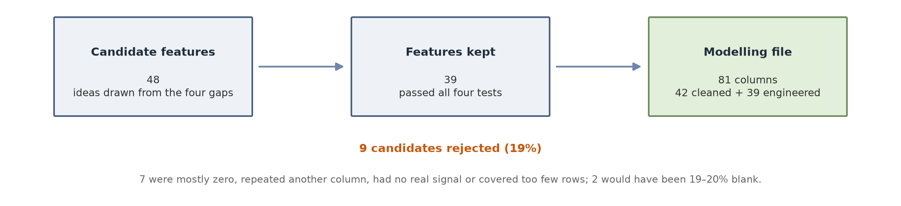
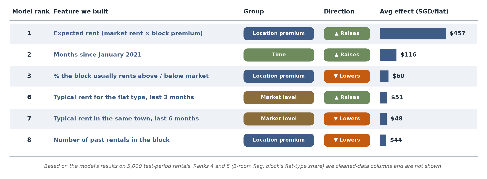

# Predicting Singapore HDB Rental Prices

**TL;DR:** A rent benchmark for 209,610 Singapore HDB rentals that a property agency can use as the starting point for every pricing discussion. On unseen 2026 rentals, the final model is off by **SGD 297 a month on average, 40% less than a simple town-and-flat-type average (SGD 495)**. Most of the gain comes from the features I engineered (recent comparable rents and each block's usual premium), not from a more complex algorithm.

**Tools:** Python · pandas · NumPy · scikit-learn · XGBoost · SHAP



## Business question

Every HDB rental starts with a price. Agents usually set the first asking rent from broad town averages, a few comparable listings or their own judgement, so similar flats can be priced on different assumptions. Pricing too low leaves the landlord's income unrealised, and pricing too high can mean a longer search for a tenant.

**Can public data give agents a consistent, evidence-based "Estimated Market Rent" as a first-pass benchmark?**

## Dataset

Four public sources, joined at block level:

- **HDB rental approvals** (data.gov.sg): 209,852 records, January 2021 to August 2026, 27 towns, 9,720 block addresses
- **HDB Property Information:** building age, height and flat mix for each block
- **OneMap:** address coordinates
- **MRT/LRT exits:** used to measure rail access

After cleaning, the modelling file has **209,610 records and 42 columns** with no missing values. Property data matched 99.91% of rental records.

The data files are not included because they are larger than GitHub's 100 MB file limit.

## What the data shows



- **The market moved fast.** The median rent rose from SGD 2,000 (January 2021) to SGD 3,200 (August 2026), mostly during 2022 and early 2023. A price that was fair a year ago may not be fair today.
- **Location matters within the same flat type.** In 2025 a 4-room flat rented for a median of SGD 4,200 in Central but SGD 3,000 in Woodlands. Rents also differ between blocks and streets in the same town.



## My part: feature engineering

The cleaned data leaves out much of what drives rent: the market level at the time of renting, a block's view or condition, floor area and storey, and how good rail access is compared with the rest of the town. I built **39 features** to fill these gaps, using only the 42 cleaned columns and no outside data.


1. **Find the gaps:** check each column against rent and ask what a landlord or tenant uses to set a price that the data doesn't show.
2. **Draft candidates:** 48 candidate features in four groups (market timing, location quality, building and unit, rail access).
3. **Screen them:** keep a feature only if it is relevant to rent, under 5% blank, not a repeat of another column, and **built only from earlier months**, so the model never learns from future rents. 9 candidates failed and were dropped.



| Group | Examples | Idea |
|---|---|---|
| Market level | `ft_median_rent_lag3m`, `town_ft_median_rent_lag6m` | Recent market rent for the same flat type and town |
| Location premium | `block_ft_past_premium`, `street_past_premium`, `expected_rent_block_ft` | How much a block or street has rented above or below the market in the past |
| Location | `postal_district`, `mature_estate`, `region` | Standard Singapore location groupings |
| Rail | `lrt_dependent`, `mrt_dist_rank_in_town`, `rail_access_category` | LRT-only access, and MRT distance compared with the rest of the town |
| Building | `remaining_lease_years`, `completion_era`, `floor_rank_in_town` | Lease left, build generation, and height within the town |
| Rental activity | `block_rentals_past12m`, `town_ft_rentals_lag3m` | How busy the local rental market is |

The full definitions and formulas are in [`feature_dictionary.csv`](feature_dictionary.csv) and [`FEATURES.md`](FEATURES.md), and the code is in [`create_features.py`](create_features.py).

**Example: expected rent.** A 4-room flat at Block 147 Lorong 2 Toa Payoh in January 2024: the typical 4-room rent was about SGD 3,300, and this block had usually rented about 12% above market, so its expected rent was about SGD 3,699. The recorded rent was SGD 3,500.


The new market-rent and block-premium features have the strongest links with rent (correlation **0.69 to 0.77**). The best original column reaches only **0.49**.

## Model evaluation

Six models were compared using a time-based split: **trained on 2021–2024, selected on 2025, and tested on January–August 2026**, so every test is on rentals the model has never seen.

| Model | 2025 validation MAE (SGD) | 2026 test MAE (SGD) | 2026 test R² |
|---|---:|---:|---:|
| Baseline (town × flat-type median) | 628 | 657 | −0.37 |
| Linear Regression | 325 | 306 | 0.55 |
| CART | 337 | 324 | 0.52 |
| Random Forest | 329 | 319 | 0.54 |
| Ridge | 324 | 304 | 0.55 |
| Lasso | 323 | 303 | 0.56 |
| **XGBoost (selected)** | **323** | 308 | 0.55 |

XGBoost was selected on 2025 validation error and refitted on 2021–2025. The baseline was refitted on the same period for a fair comparison:

| | 2026 MAE (SGD) | |
|---|---:|---|
| Simple benchmark (town × flat-type median) | 495 | |
| **Final XGBoost model** | **297** | **40% lower error**; RMSE 427; R² 0.57 |

**The leading models perform almost the same.** Even plain Linear Regression is within SGD 10 of XGBoost, so the improvement comes mainly from the engineered market and location features, not from model complexity.

## Key results



- **Recent comparable rents drive most of the prediction.** In the final model, my expected-rent feature (recent flat-type rent adjusted by the block's usual premium) accounts for **49% of the model's total SHAP attribution**. Recent town-level rent is next.
- **Block and street premiums matter.** Street-level premiums and building age add smaller adjustments around the market level.
- **Accuracy varies by segment.** Errors are lowest in newer, uniform towns such as Punggol (SGD 196) and Sengkang (SGD 220), and highest for Executive flats (SGD 395) and thin markets such as Bukit Timah (SGD 503, only 72 rentals).

## Recommendation

1. **Pilot the model as the standard first-pass benchmark** for a group of towns, and compare it with the agents' current approach.
2. **Show a range with a confidence indicator**, not a single figure, based on the observed errors for that segment.
3. **Keep the data fresh.** Recent comparable rents are the strongest signal, so regular data updates are a core requirement.
4. **Keep human review for low-confidence cases**, such as Executive flats and towns with few rentals.
5. **Improve the data before the algorithm.** Floor level, furnishing and renovation condition would likely add more accuracy than a more complex model.
6. **Measure business outcomes in the pilot**, such as how often agents override the benchmark and how long pricing decisions take.

## Limitations

- The data has no floor area, floor level, furnishing or condition, so flats in the same block cannot be fully told apart.
- Rents are owner-declared, and rail access is straight-line distance, not walking time.
- There is no data on asking prices, vacancy length or days to rent, so the project cannot yet measure the revenue impact.
- SHAP values show what the model relies on, not what causes rent.

## How to run

```powershell
pip install pandas numpy
python create_features.py
```

The script expects the cleaned input at `data/hdb_rentals_clean.csv`.

## About this project

This was a team project for the NTU MSc Business Analytics, written as a pricing-benchmark proposal for a Singapore property agency. **I led the feature engineering stage**: the 39 features, their screening and the leakage checks. Other team members handled the remaining stages, including the final model; its results are shown here because they measure the impact of the features.
